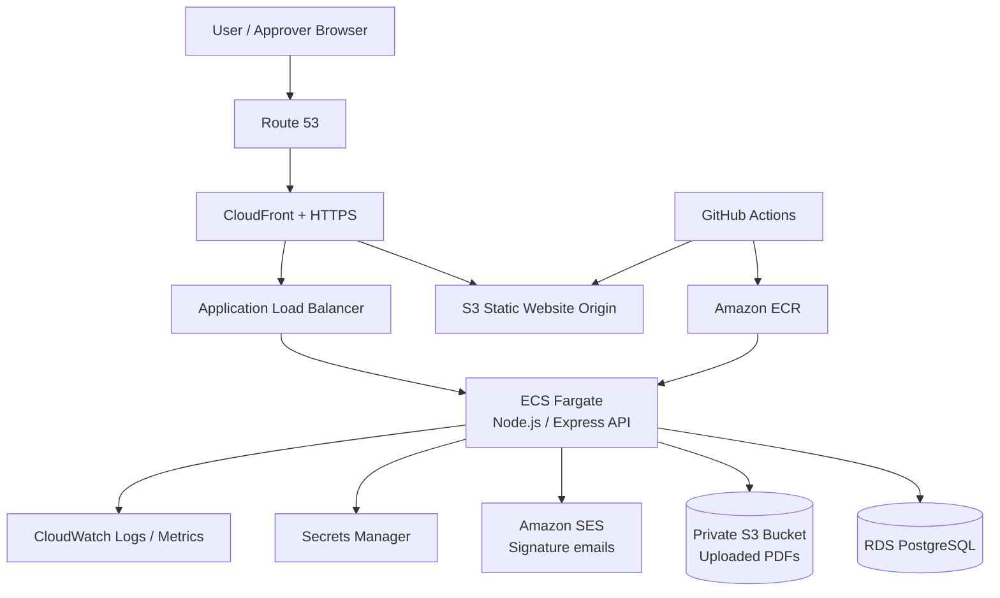

# AWS Deployment Design

This is a proposed production-oriented deployment. **No AWS resources have been created and no deployment has been performed.**

## High-level architecture

## Services and responsibilities

| Concern | AWS service | Design |
|---|---|---|
| DNS and TLS | Route 53 + ACM | Point the application domain to CloudFront and use managed TLS certificates. |
| Frontend hosting | S3 + CloudFront | Build the React/Vite frontend and publish static assets to a private S3 bucket served through CloudFront. |
| API hosting | ECS Fargate + ALB | Run the containerized Express API across private subnets; expose it through an HTTPS Application Load Balancer. |
| Relational data | Amazon RDS for PostgreSQL | Store users, projects, project instances, document metadata and workflow events. Use automated backups and Multi-AZ for production availability. |
| PDF storage | Private Amazon S3 bucket | Store uploaded PDFs using generated object keys, not user-supplied filenames. Enable encryption, versioning and lifecycle/retention policies. |
| Email | Amazon SES | Send approval/signature notifications from a verified domain. Record delivery/bounce outcomes. |
| Secrets | AWS Secrets Manager | Store database credentials, session/signing secrets and SMTP/SES configuration. Inject them at runtime; never commit secrets. |
| Monitoring | CloudWatch | Centralize structured application logs, metrics, alarms and container health signals. |
| Container registry | Amazon ECR | Store versioned backend images for deployment. |
| CI/CD | GitHub Actions with OIDC | Build, test, scan and publish artifacts; deploy frontend assets and update the ECS service without long-lived AWS access keys. |

## Request and file flow

1. The browser loads the React application from CloudFront.
2. API requests go to the API origin over HTTPS. The API validates the authenticated session and role before each protected operation.
3. The API stores workflow metadata in RDS PostgreSQL.
4. Uploaded PDFs are validated by the API and written to a private S3 bucket. The database stores the object key and metadata, not the file bytes.
5. When an approver reviews a document, the API checks access rights and either streams the file or issues a short-lived pre-signed S3 URL after authorization.
6. On approval, the API records the workflow transition and asks SES to send the signature notification.
7. Signing records the authenticated approver, timestamp and workflow event. For legally binding signatures, integrate a dedicated e-signature provider.

## Security controls

- Put ECS tasks and RDS in private subnets. Only the ALB should accept inbound public traffic.
- Enforce HTTPS using ACM certificates; set secure, HTTP-only cookies and an appropriate SameSite policy.
- Use a strong, rotated session/signing secret from Secrets Manager. Do not use the local development fallback secret.
- Apply least-privilege IAM task roles: the API should access only the required S3 bucket/prefix, secrets and SES identity.
- Keep the PDF bucket private with Block Public Access enabled and server-side encryption (SSE-S3 or SSE-KMS).
- Validate upload size, file type and file signature; add malware scanning before files become available for review.
- Enforce ownership and approver authorization in the API, not only in the frontend.
- Add CSRF protection appropriate to the cookie-based authentication model, rate limiting, request validation and security headers.
- Encrypt RDS storage and backups; require TLS for database connections.
- Avoid logging passwords, session cookies, secrets or document contents. Audit important workflow actions.

## CI/CD outline

1. A pull request runs frontend lint/build checks, backend TypeScript compilation and backend tests.
2. Dependency and container vulnerability scans run before release.
3. On merge to the deployment branch, GitHub Actions authenticates to AWS using OIDC.
4. The workflow builds the backend container and pushes a versioned image to ECR.
5. It builds the frontend and syncs the static output to the frontend S3 bucket, then invalidates the CloudFront cache.
6. It updates the ECS task definition to the new image and deploys the service using a rolling deployment with health checks.
7. A post-deployment smoke test checks the frontend route and API health endpoint. Failed health checks trigger rollback to the previous ECS task definition.

## Migration from the assessment implementation

The local assessment version uses SQLite and a local `storage/` directory. For AWS, migrate the relational schema/data to RDS PostgreSQL and move document objects to S3. Replace filesystem paths with S3 object keys and adapt the document-view route to authorize access before streaming or creating a short-lived pre-signed URL. The current local `.env` values and hard-coded frontend API URL should become environment-specific deployment configuration.

## Trade-offs

ECS Fargate is a good fit for the existing Express API because it requires minimal application restructuring and supports predictable container deployments. Lambda/API Gateway could reduce idle cost for a low-volume API, but would require adapting the server lifecycle and validating SQLite removal first. RDS PostgreSQL and S3 add operational cost compared with SQLite and local files, but provide durable shared storage, backups and horizontal scalability.
